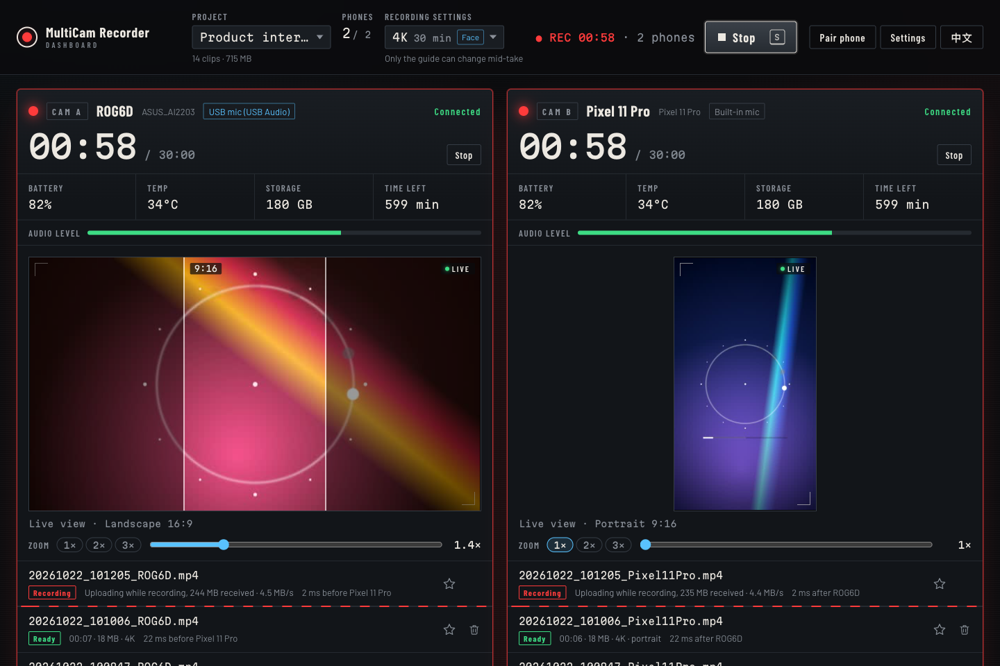

<p align="center">
  
</p>

<h1 align="center">MultiCam Recorder｜多機錄影</h1>

<p align="center">
  <b>免費開源的手機多機位錄影工具：用電腦一鍵遙控多支 Android 手機同步錄影</b><br>
  即時畫面・手機原生 4K・臉部優先・直式＋橫式同時錄・邊錄邊傳回電腦・支援 macOS／Windows
</p>

<p align="center">
  <a href="https://github.com/dean9703111/multicam-recorder/releases/latest"></a>
  <a href="https://github.com/dean9703111/multicam-recorder/actions/workflows/ci.yml"></a>
  
  
  <a href="LICENSE"></a>
</p>

<p align="center">
  <a href="https://deanlin.net/multicam-recorder/"><b>產品網站</b></a> ・
  <a href="#快速開始"><b>快速開始</b></a> ・
  <a href="#適合哪些情境">使用情境</a> ・
  <a href="#功能特色">功能特色</a> ・
  <a href="#規格一覽">規格</a> ・
  <a href="#常見問題">常見問題</a> ・
  <a href="#疑難排解">疑難排解</a> ・
  <a href="#關於作者">關於作者</a> ・
  <a href="#english">English</a>
</p>


<p align="center"><sub>電腦上的控制台：兩支手機同時錄 4K，左邊橫拿 16:9、右邊直拿 9:16。每台都看得到即時畫面，影片一邊錄一邊傳回電腦。<br>（畫面中的漸層動畫來自開發用的模擬手機，實際使用時就是手機拍到的畫面。）</sub></p>

## 多機錄影是什麼？

**多機錄影（MultiCam Recorder）是一套免費、開源的多機位錄影工具，把手邊的 Android 手機變成可以同步錄影的攝影機。** 在電腦（macOS 或 Windows）上打開網頁控制台，就能同時看到每支手機的即時畫面、各自調整變焦，按一個鍵讓所有手機在同一刻開始錄影。

影片是在每支手機上**用手機原生畫質錄的，最高 4K**，錄影中就一邊傳回電腦，停止後很快就能在電腦上播放檢查。整個過程只用家裡或辦公室的 **Wi-Fi 區域網路**，**不需要雲端帳號，影片也不會上傳到網路**。

### 和每支手機各自按錄影，差在哪？


| | ❌ 每支手機各自錄 | ✅ 用多機錄影 |
| --- | --- | --- |
| **開始錄影** | 一支一支跑去按，開始時間差好幾秒 | **按一次 `R`，所有手機約好同一刻開始** |
| **看畫面** | 只看得到眼前那一支 | **電腦上同時看每支的即時畫面** |
| **拿到檔案** | 錄完再一支一支傳、改檔名 | **邊錄邊傳回電腦，自動命名、確認檔案完整** |
| **注意狀態** | 電量、空間不夠時才發現 | **電量、溫度、剩餘空間、還能錄幾分鐘一目瞭然** |

## 適合哪些情境？


- **訪談、Podcast**：主持人和來賓各一台，外接麥克風接在其中一台當主音軌，剪輯時隨時切換角度。
- **同時做長影片和短影音**：一台橫拿錄 YouTube 用的 16:9，一台直拿錄 Reels、Shorts、TikTok 用的 9:16，一次錄好兩種版本。[詳細做法](#使用情境一次錄好長影片和短影音)
- **課程、講座**：一台在後面拍全景，一台在側邊拍講者和白板。
- **產品拍攝、開箱**：正面、正上方俯拍、側面特寫同時錄，最多可以接 10 台手機。

## 功能特色

**錄影**

- **一鍵同步開始、停止**：按 `R` 全部開始、`S` 全部停止，也能單獨控制某一台。開始前電腦會先和每台手機對時，約好同一刻一起開始，清單上會顯示各台實際的開始時間差。
- **手機原生畫質**：4K、2K、1080p、720p 可選，所有手機一起套用。單段上限可以自己設 10～90 分鐘，剩 3 分鐘時網頁和手機都會提醒。
- **直式、橫式都能錄**：手機橫拿錄 16:9、直拿錄 9:16，App 會自動跟著手機轉，錄影中鎖住方向。
- **人像設定**：「臉部優先」預設開啟，對焦、曝光、白平衡都以人臉為準；也可以在錄影時鎖定曝光、白平衡和對焦，亮度、顏色和對焦都不會錄到一半變掉。這些都交給手機的相機處理，**畫質和解析度都不變**。[詳細說明](#人像設定臉部優先鎖定曝光)
- **外接麥克風**：接上 USB 或耳機孔麥克風會自動改用它收音，App 和網頁都會顯示目前用的是哪一支；支援雙聲道的會錄雙聲道，雙發射器的無線麥克風設成左右分開時，兩個人的聲音可以分開調整。

**監看**

- **即時畫面**：每秒約 5 張，用來確認構圖。按下開始錄影時，監看區一律切回即時畫面，隨時知道現在拍到什麼。
- **各別變焦**：常用倍率的按鈕加上滑桿，每台各自設定；有超廣角或望遠鏡頭的手機會自動換鏡頭。
- **構圖輔助框**：在手機預覽、即時畫面和播放器上疊一個 9:16、4:5 或 1:1 的框，架機時就照最後要出的比例構圖。
- **狀態一目瞭然**：每台的電量、溫度、剩餘空間、還能錄幾分鐘、傳輸速度。電腦的硬碟快滿、傳輸停住、手機斷線時都會直接提示。
- **出問題馬上知道**：錄影中每台都有音量表。沒有聲音、爆音、外接麥克風鬆脫、手機太熱時，控制台上方會說清楚是哪一台、可以怎麼辦；空間或電量不夠錄完一段，按 `R` 時就先提醒。

**傳檔與整理**

- **錄完馬上看**：錄影中就邊錄邊傳，停止後只要補最後一小段，再用 SHA-256 分段比對，確認和手機上的檔案一模一樣，就能在網頁播放原檔。短片幾秒內就好，30 分鐘的 4K 大約多等十幾秒。
- **斷線也不怕**：Wi-Fi 斷掉時手機照常錄影，連回來會自動續傳。
- **用專案整理**：開錄前先選專案，影片會存進「錄影資料夾／專案名稱」，檔名是時間加手機名稱，例如 `20261020_143005_ROG6D.mp4`，同一段的檔案會排在一起。
- **標記好的段落、一次清掉其他的**：點星號標記好的段落，同一段的每台手機一起標記；每一列右邊的垃圾桶可以刪掉那一段，沒標記的也能一鍵全部移到垃圾桶（Windows 是資源回收筒），刪錯了也救得回來。
- **裁掉頭尾**：在有縮圖的時間軸上拖拉開頭和結尾，同一段的每台手機一起裁，另存成檔名加 `_1` 的新檔，原本的影片不動。不重新壓縮，畫質不變。[詳細說明](#5-播放標記與整理影片)
- **掃 QR Code 配對**：用手機相機掃一次就好，不用輸入 IP。還沒裝 App 的話，掃完打開的網頁裡就有下載連結。
- **中文、英文介面**：控制台、配對網頁和手機 App 都有繁體中文和英文。控制台跟著瀏覽器的語言，右上角可以一鍵切換；App 跟著手機的語言。

## 規格一覽

| 項目 | 說明 |
| --- | --- |
| 價格 | **免費**，MIT 授權開源 |
| 電腦 | macOS、Windows，需要 [Node.js](https://nodejs.org/) 24 以上 |
| 手機 | Android 12 以上，**最多 10 台**；目前沒有 iPhone 版 |
| 解析度 | 4K（3840×2160）、2K（2560×1440）、1080p、720p，每秒 30 格；直拿時寬高對調。手機錄不到所選的解析度時，改用它能錄、又不超過所選的最高解析度，控制台會先寫出來 |
| 影片格式 | MP4（H.264 影像、AAC 聲音），4K 約 40 Mbps |
| 人像設定 | 臉部優先（預設開）、錄影時鎖定曝光、白平衡和對焦（預設關） |
| 單段長度 | 10～90 分鐘，自己設（預設 30）；4K 每 30 分鐘每台約 9 GB |
| 裁剪 | 只裁頭尾、每台手機一起裁、另存新檔，不重新壓縮（需要另外安裝 ffmpeg） |
| 連線方式 | 手機和電腦連同一個 Wi-Fi，影片只在區域網路裡傳輸 |
| 收音 | 手機內建麥克風，或 USB、耳機孔外接麥克風（支援雙聲道的錄雙聲道） |
| 即時畫面 | 每秒約 5 張（橫拿 640×360、直拿 360×640） |
| 介面語言 | 繁體中文、英文（控制台、配對網頁、手機 App） |

## 運作方式


- **電腦**上跑一個本機伺服器，同時提供網頁控制台。控制台只能在這台電腦上開，同一個網路的其他裝置打不開。
- **手機 App** 用 WebSocket 接收開始、停止、變焦等指令並回報狀態，也用它傳即時畫面（電腦上有人在看時才傳）；影片則用 HTTP 分段傳回電腦。
- **錄影在手機上進行**（Camera2＋MediaRecorder），所以畫質不受 Wi-Fi 影響，Wi-Fi 只負責傳檔和控制。
- **錄影中就邊錄邊傳**，按下停止後只補最後一小段、用 SHA-256 驗證完就能播放，不用等錄完再一支一支傳：


## 快速開始

> [!TIP]
> 第一次設定大約 15 分鐘：在電腦上裝好 Git、Node.js 和多機錄影，手機裝好 App、掃 QR Code 配對，再新增專案就能開始錄影。之後每次只要在終端機執行 `npm start`、打開 App。

### 1. 安裝並啟動電腦端

電腦端要在「終端機」裡打幾行指令來安裝，**照著複製貼上就好**。每一步都寫了怎麼確認成功；出現錯誤的話，請看[疑難排解](#疑難排解)。

**① 打開終端機**

- **macOS**：按 `⌘`＋`空白鍵`，輸入「終端機」，按 Enter。
- **Windows**：按「開始」，輸入 `cmd`，打開「命令提示字元」。請不要用 PowerShell，它可能會擋下 npm。

**② 安裝 Git**：下載和更新多機錄影都會用到。

- **macOS**：執行下面這行，跳出視窗時按「安裝」，等它裝完。顯示 `already installed` 的話，表示已經裝過了，直接到下一步。

  ```sh
  xcode-select --install
  ```

- **Windows**：到 [git-scm.com](https://git-scm.com/downloads/win) 下載安裝程式，選項都用預設的，一路按「Next」。裝好後關掉命令提示字元，再打開一個新的。

**③ 安裝 Node.js 24 以上**：先執行 `node -v`。顯示 `v24` 或更新的版本的話，直接跳到第 ④ 步。

- **macOS**：用 [nvm](https://github.com/nvm-sh/nvm) 安裝，執行下面兩行：

  ```sh
  touch ~/.zshrc
  curl -o- https://raw.githubusercontent.com/nvm-sh/nvm/v0.40.8/install.sh | bash
  ```

  跑完後**關掉終端機，再打開一個新的**，執行：

  ```sh
  nvm install --lts
  ```

- **Windows**：用 [nvm for Windows](https://github.com/nvm-windows/nvm/releases) 安裝。在最新版的 Assets 裡下載結尾是 `x64-setup.exe` 的檔案（Snapdragon 這類 ARM 處理器的電腦選 `arm64-setup.exe`），直接雙擊安裝，不要用「以系統管理員身分執行」。電腦裡有舊版的 Node.js 的話，先到「設定 → 應用程式」解除安裝。裝好後**關掉命令提示字元，再打開一個新的**，執行：

  ```sh
  nvm install lts
  nvm use lts
  ```

再執行一次 `node -v`，看到 `v24` 以上就好了。

**④ 下載並啟動多機錄影**：執行下面四行，第一次的 `npm install` 會下載需要的套件，大約 1 分鐘。

```sh
git clone https://github.com/dean9703111/multicam-recorder.git
cd multicam-recorder
npm install
npm start
```

看到 `控制台：http://localhost:8787` 就成功了，瀏覽器會自動打開控制台；沒有打開的話，自己用瀏覽器打開 <http://localhost:8787>。

> [!IMPORTANT]
> **錄影時，執行 `npm start` 的終端機要一直開著**，關掉就會停止。拍完要結束時，按 `Ctrl`＋`C` 或直接關掉視窗。

**之後每次要用**，打開終端機執行這兩行就好：

```sh
cd multicam-recorder
npm start
```

用 Linux 的話，先用套件管理員裝 git 和 curl（例如 `sudo apt install git curl`），再照 macOS 的方式用 nvm 裝 Node.js。

啟動後，控制台上的「開始使用」會帶你走完三個步驟：確認錄影資料夾、配對手機、新增專案。


- **錄影資料夾**預設是「影片」資料夾底下的 `MultiCamRecorder`（macOS 是 `~/Movies/MultiCamRecorder`，Windows 是 `~/Videos/MultiCamRecorder`）。要改的話按右上角「設定」，再按「選擇資料夾…」挑一個，**建議選外接 SSD**；也可以直接貼上路徑。資料夾必須已經存在。選好後，下面馬上會寫出那個資料夾剩多少空間和硬碟格式，不能用的話也會說明原因；確認沒問題再按「儲存」。
- 想用「裁掉頭尾」的話，另外安裝 [ffmpeg](https://ffmpeg.org/)：macOS 執行 `brew install ffmpeg`（要先裝 [Homebrew](https://brew.sh/)），Windows 執行 `winget install Gyan.FFmpeg`，Linux（Ubuntu、Debian）執行 `sudo apt install ffmpeg`。不裝也能正常錄影和傳檔；控制台開著的時候才裝也沒關係，在安裝說明的視窗按「重新檢查」就能用。
- **防火牆**：第一次啟動時，系統可能會問要不要讓 node 接受連入的連線，不允許的話手機會連不到電腦。
  - macOS：按「允許」。
  - Windows：跳出「Windows 安全性警訊」時，**「私人網路」和「公用網路」兩個都勾**，再按「允許存取」。只勾一個的話，Windows 把你的 Wi-Fi 當成另一種網路時，手機一樣連不到。
  - 按錯或按了「取消」：打開「控制台 → Windows Defender 防火牆 → 允許應用程式或功能通過 Windows Defender 防火牆」，按「變更設定」，把「Node.js JavaScript Runtime」那一列的「私人」和「公用」都勾起來，再按「確定」。

### 2. 安裝手機 App

1. 到 [Releases](https://github.com/dean9703111/multicam-recorder/releases/latest) 下載 **`MultiCamRecorder.apk`**，傳到手機上點開安裝。也可以直接跳到下一步，用手機相機掃配對的 QR Code，打開的網頁裡就有下載連結。
2. 第一次安裝時，手機會要你允許瀏覽器或檔案 App「安裝不明應用程式」。Google Play 安全防護也可能跳出提醒或建議先掃描，因為這個 App 不是從 Google Play 下載的，讓它掃描完再繼續安裝就好。想確認下載到的 APK 真的是作者發佈的，請看[這個 App 安全嗎？](#這個-app-安全嗎)
3. 之後有新版時，下載新的 APK 直接安裝就會覆蓋舊版，**配對和設定都會保留**。App 太舊時，控制台會提醒，並顯示下載新版的 QR Code。

想自己從原始碼編譯 App，請看[開發者文件](docs/development.md#自己編譯-app)。

### 3. 配對手機


1. 在電腦網頁按 **「配對手機」**，畫面會出現 QR Code，10 分鐘內有效。
2. 用手機相機掃描，點開出現的連結。
3. 在打開的網頁按 **「打開 App 並配對」**。App 會自動打開，第一次會詢問相機和麥克風權限。還沒裝 App 的話，按下去會先下載 App，裝好後回到這一頁再按一次。
4. 完成後，電腦網頁上會多一個這支手機的監看區。

也可以打開 App，點右下角「掃描 QR Code」直接掃。**每支手機只要配對一次**，之後打開 App 就會自動連線。手機名稱可以在網頁上點一下修改，之後的檔名也會用這個名稱。

### 4. 新增專案、開始錄影

- **專案**：按上方「專案」選單裡的「新增專案…」，預設名稱是今天的日期。影片會存進「錄影資料夾／專案名稱」。還沒有專案就按開始的話，會先請你新增一個。
- **錄影規格**：「錄影規格」選單可以選解析度、構圖輔助框和人像設定，所有手機一起套用。解析度和人像設定從下一次開始錄影時生效，錄影中不能改；輔助框隨時可以換。手機錄不到選的解析度時，會改用它能錄、又不超過所選的最高解析度（預設選 4K，所以就是每支手機各自的最高畫質）。開始錄影前，那台的卡片上和「錄影規格」選單裡就會寫出來，例如「這支手機錄不到 4K，改用 1080p 錄」，錄好的影片清單上也會標出實際的大小。
- **人像設定**：「臉部優先」預設開著，拍人不用特別調。要鎖定曝光的話，在同一個選單打開，做法請看[人像設定](#人像設定臉部優先鎖定曝光)。
- **即時畫面與變焦**：監看區平常顯示手機的即時畫面。下面的「變焦」可以按常用倍率或拖滑桿，每台手機各自設定，邊看即時畫面邊調；App 重開也會記得，錄影中也能調。
- **直拿或橫拿**：手機怎麼放就錄怎麼樣的影片，橫拿 16:9、直拿 9:16，系統的自動旋轉關著也一樣。一台直、一台橫同時錄的做法，請看[使用情境](#使用情境一次錄好長影片和短影音)。
- **開始和停止**：按網頁上的「開始錄影」或鍵盤 `R`，所有手機一起開始；「停止」或 `S` 全部停止。每個監看區也有「單獨開始／單獨停止」。快捷鍵只在控制台分頁是目前視窗時有效。錄影中，頂列會顯示「● REC 12:34・2 台」，瀏覽器的分頁標題也會跟著變，切到別的分頁也看得出來還在錄。
- **到單段上限會自動停止**：預設 30 分鐘，在「錄影規格」的「單段上限」可以改成 10～90 分鐘（直接打數字，或按 − ＋ 一次調 5 分鐘），旁邊會寫錄滿一段每台手機要多少空間。最後 3 分鐘網頁會跳出提示並發出提示音；電腦離麥克風很近的話，提示音可能會被錄進去，可以在「設定」把「提示音」關掉。
- **開始前先檢查**：按 `R` 時，如果有手機的空間不夠錄完一段、電量太低又沒充電，或電腦的錄影資料夾快滿了，會先告訴你是哪一台、大概能錄多久、可以怎麼辦，再讓你選「仍要開始」或「取消」。
- **錄影中的警示**：每台都有音量表；超過 10 秒沒有聲音、爆音、外接麥克風鬆脫改用手機內建麥克風，或手機太熱時，控制台上方會跳出警示，捲動時也看得到。

> [!IMPORTANT]
> 錄影時 App 要一直開在前景，螢幕不能關，因為 Android 不允許背景 App 使用相機。錄影中按返回鍵不會離開 App；建議開啟手機的「固定應用程式」（在設定裡搜尋「固定」），連切換 App 的手勢也擋得住。長時間錄影可以按 App 上的「調暗螢幕」省電、降溫。


手機上的 App 畫面長這樣：


1. **手機名稱、連線狀態**：名稱可以在電腦網頁上點一下修改。連不上電腦太久時，這裡會提示檢查伺服器和 Wi-Fi。
2. **錄影計時**：最後 3 分鐘會變成琥珀色，並顯示剩餘時間。
3. **收音來源、變焦**：接上外接麥克風後，請確認這裡顯示「外接 USB」或「耳機孔外接」。下面一行是目前的變焦倍率。
4. **傳輸狀態**：「邊錄邊傳中」「還有 1 支在收尾」，或「影片都已傳到電腦」。
5. **調暗螢幕**：長時間錄影時省電、降溫。
6. **掃描、清除已傳完的影片**：錄影中會停用，避免誤觸而中斷錄影。還沒配對時，掃描按鈕會變成紅色。
7. **構圖輔助框**：在電腦上選了 9:16、4:5 或 1:1 時，會疊在預覽上。

手機直拿時，App 的畫面也會轉成直的，內容一樣，只是排列不同：名稱和收音在上面，計時在下一行，上傳狀態和三個按鈕在最下面。直拿時寬度比較窄，「清除已傳完的影片」會簡寫成「清除已傳完」，按下去一樣會先列出要刪的影片讓你確認。

<p align="center">
  
</p>

### 5. 播放、標記與整理影片

- **停止後馬上看**：影片傳完會自動放進那台手機的監看區播放，按「回到即時畫面」回去；點清單上的任何一列，就會在監看區播放那一支。按下開始錄影時，監看區會一律切回即時畫面，原本在播的影片會停掉；錄影中，上一段傳完也不會自動切去播放。
- **打開資料夾**：監看區下方的「在 Finder 中顯示」（Windows 是「在檔案總管中顯示」）會直接打開影片所在的資料夾，「專案」選單裡也有「打開專案資料夾」。
- **標記和清理**：覺得不錯的段落點右邊的星號，同一段的每台手機會一起標記。不要的那一段，點最右邊的垃圾桶，確認後同一段的每台手機一起移到垃圾桶（只有一台手機時就是那一支）。「專案」選單裡的「把沒標記的移到垃圾桶…」會一次清掉其他段；「選取要刪除的影片…」可以自己勾選，只想刪其中一台時用這個（「選取沒標記的」能先幫你勾好）。刪掉的影片會進系統的垃圾桶（Windows 是資源回收筒），刪完的提示上可以直接按「打開垃圾桶」；刪錯了，在垃圾桶裡對影片按右鍵選「放回原處」（Windows 是「還原」），就會回到專案資料夾。手機上的原檔不受影響。


- **裁掉頭尾**：開頭等人坐好、結尾收拾東西的片段，可以先在這裡裁掉，剪輯時就不用一支一支找。
  1. 點清單上的那一段，在監看區播放，再按影片下方的「裁剪…」，會出現一條有縮圖的時間軸。
  2. 拖時間軸左右兩邊的把手設定開頭和結尾，拖的時候監看區會跳到那一格，看得到從哪裡開始、到哪裡結束。點時間軸可以跳到那裡，按「播放這段」會從開頭播到結尾。要微調的話，點一下把手再按方向鍵（每次 0.1 秒，按著 Shift 每次 1 秒）。
  3. 按「裁剪」。**同一段的每台手機會一起裁**，用開始時間差換算，裁的是同一段時間。
  4. 裁好的影片另存成檔名後面加 `_1` 的新檔（同一支再裁一次就是 `_2`、`_3`），**原本的影片不動**。裁好會直接在監看區播放，清單上標「裁剪過」。
- 裁剪不重新壓縮，畫質完全不變，幾 GB 的 4K 也只要幾秒。代價是開頭只能從關鍵影格開始，所以可能比你設的早一點（手機大多每 1 秒一個關鍵影格）；各台的關鍵影格位置不同，裁好的幾支開始時間會差零點幾秒，清單上會標出來，剪輯時一樣用音訊對齊。
- 裁剪要用到 ffmpeg。沒裝的話按「裁剪…」會跳出安裝說明，只列你電腦的系統（macOS、Windows 或 Linux）要用的指令，可以一鍵複製；裝好後按「重新檢查」，找到就直接打開時間軸，不用重新啟動。

<p align="center">
  
</p>

- 傳輸中的檔案副檔名是 `.part`，驗證通過後才改成 `.mp4`。
- 清單上會顯示同一次錄影的各台開始時間差幾毫秒，剪輯時可以參考；要精準對齊，建議用剪輯軟體依音訊自動同步。
- 在 Finder 或檔案總管裡刪掉影片或專案資料夾，清單上也會跟著拿掉。外接硬碟沒接上時紀錄會先保留，接回來就恢復。
- 手機上的原檔不會自動刪除。確認電腦上的檔案沒問題後，可以在 App 按「清除已傳完的影片」，它只會刪掉已經傳到電腦並驗證過的檔案。

### 更新到新版

在終端機執行下面四行。配對、專案和設定都會保留，影片也還在原本的錄影資料夾。

```sh
cd multicam-recorder
git pull
npm install
npm start
```

- **之前用 ZIP 下載的**（v0.5.0 或更早）：照[安裝並啟動電腦端](#1-安裝並啟動電腦端)裝好 Git、用 `git clone` 重新下載一次（第 ②、④ 步）。執行 `npm start` 之前，先把舊資料夾裡的 `data` 資料夾複製到新的 `multicam-recorder` 資料夾，配對才會跟著搬過去。之後更新就照上面做。
- **手機 App**：見[安裝手機 App](#2-安裝手機-app)的第 3 點。目前的版本寫在控制台「設定」的最下面，旁邊有「看最新版」的連結。

## 開拍前準備清單

正式開拍前花一分鐘檢查，最常見的意外都能先避開：

- [ ] **手機空間夠**：「錄影規格」的單段上限旁邊會寫每支手機要空出多少（4K 每 30 分鐘約 9 GB）。不夠的話，按 `R` 時也會先提醒是哪一台。
- [ ] **手機接上充電**，長時間錄影可以按 App 上的「調暗螢幕」省電、降溫。
- [ ] **手機開啟「固定應用程式」和勿擾模式**：來電或不小心切到別的 App，那一台都會提早停止。
- [ ] **電腦接上電源，不要闔上螢幕**：闔上會讓電腦睡著，錄影控制和傳輸都會停下來。
- [ ] **執行 `npm start` 的終端機開著**，控制台上每一台都看得到即時畫面。
- [ ] **外接麥克風**：App 和控制台上的收音來源顯示「外接 USB」或「耳機孔外接」。
- [ ] **試錄 10 秒**：按 `R`、說幾句話、按 `S`，確認每台的音量表會動、影片傳完能播放。

## 使用情境：一次錄好長影片和短影音


例如訪談、講座、產品介紹，同一段內容想剪成 YouTube 的橫式長片，也想剪成 Reels、Shorts、TikTok 的直式短片：

- 一支手機**橫放**，拍 16:9 的畫面，剪長影片用。
- 另一支**直放**，拍 9:16 的畫面，剪短影音用。直接錄直的，不用從橫的畫面裁切，解析度比較高：4K 直拿錄的是 2160×3840，從 4K 橫的畫面裁出直的只剩大約 1215×2160，**畫素差了約 3 倍**。
- 按一次 `R` 兩支一起開始、按 `S` 一起停止，兩邊錄的是同一段時間，剪輯時很好對齊。

### 架設與錄影

1. **照想要的方向架好手機**：App 會跟著手機轉，直放錄 9:16、橫放錄 16:9，系統的「自動旋轉」關著也一樣。四個方向都可以，倒過來放也行（例如讓麥克風線往下走），錄出來都是正的。
2. **在控制台確認方向**：直放那台的監看區會變成直的，下方寫著「即時畫面・直式 9:16」；橫放的寫「即時畫面・橫式 16:9」。方向不對的話，把手機轉一下，控制台馬上跟著變。
3. **看即時畫面構圖**：每台各自調變焦。需要的話，在「錄影規格」選單打開構圖輔助框：
   - 橫的那台選 9:16，可以看出之後從橫的畫面裁出直式時，主角會不會出框。
   - 直的那台選 4:5 或 1:1，可以看出 IG 貼文的裁切範圍。9:16 就是直的那台的整個畫面，所以直的那台不會畫框。
4. **開始錄影**：按 `R` 或「開始錄影」，每台的監看區都會切回即時畫面，原本在播的影片會停掉，可以直接確認現在拍到什麼。錄影中，上一段傳完也不會自動切去播放。
5. **錄影中方向固定**：從按下開始到停止，方向都不會變，中途碰到手機也不會錄成一半直、一半橫。停止後，App 才會再跟著手機轉。
6. **停止後馬上檢查**：每台的影片傳完會自動在監看區播放，直式影片會直著播，清單上也會標「直式」。覺得不錯就點星號，同一段的兩支會一起標記。

### 剪輯時

- 直拿的影片和手機內建相機拍的一樣，檔案裡存的是橫的畫面，另外記著播放時要轉 90°。大部分的播放器和剪輯軟體都會自動轉正；遇到不認得的工具，在軟體裡把片段旋轉 90° 就好。
- 清單上會顯示同一段裡各台的開始時間差幾毫秒；要精準對齊，建議用剪輯軟體依音訊自動同步。

> [!NOTE]
> 從正上方往下拍時，手機平放分不出直橫，會沿用平放前的方向。請先拿成想要的方向、等畫面轉好，再放平。

## 人像設定：臉部優先、鎖定曝光

拍訪談、Podcast、課程這類以人為主的內容時，「錄影規格」選單最下面的「人像」有兩個設定，所有手機一起套用。**全部交給手機的相機處理，解析度、位元率和每秒格數都不變**。

<p align="center">
  
</p>

| 設定 | 預設 | 效果 | 適合 |
| --- | --- | --- | --- |
| **臉部優先** | 開 | 對焦、曝光、白平衡以人臉為準：背後有亮窗時臉不會黑掉，對焦也不會跑到背景。光線平均、人在畫面中間時，看起來和一般的自動模式一樣 | 有人入鏡的拍攝 |
| **錄影時鎖定曝光、白平衡和對焦** | 關 | 按下開始的那一刻鎖住，到停止前亮度、顏色和對焦都不變 | 人和燈光都固定的訪談 |

### 臉部優先

<p align="center">
  
</p>

- **大部分手機都做得到**：Android 規定，相機只要支援臉部偵測，就要提供這個模式。萬一哪台做不到，選單裡會提醒，那台就照一般的自動模式錄。
- **它不是看得出來的特效**，而是讓相機在難拍的光線下把臉拍對：人背對窗戶時，曝光以臉為準，臉不會黑掉；對焦也不會跑到背景。光線平均、人在畫面中間時，結果和自動模式差不多。

### 鎖定曝光、白平衡和對焦

<p align="center">
  
</p>

- 平常手機會一直自動調整亮度和顏色。錄到一半有人走過、窗外的雲飄過，畫面就跟著變；兩台手機還會各變各的，剪輯時很難對色。
- 打開後，每台在**按下開始的那一刻**鎖住當下的亮度、顏色和對焦，停止後恢復自動。錄影中，監看區下方會寫「已鎖定」。
- 對焦一起鎖住，訪談時畫面不會忽遠忽近地「呼吸」。人會前後走動的話，請關掉。
- 開始前先讓畫面穩定下來（例如人先坐好、燈先打開），鎖住的才是你要的樣子。
- 適合人和燈光都固定的室內訪談。**戶外或燈光會變的場合請關掉**，不然光線一變，畫面就會太亮或太暗。

沒有背景虛化、濾鏡和美顏，原因請看常見問題的[有人像模式嗎？](#有人像模式嗎可以背景虛化嗎)和[有濾鏡或美顏嗎？](#有濾鏡或美顏嗎)。

## 網路設定建議


- **最好讓電腦接網路線**：這樣每支手機的影片在空中只要走一段。
- **或讓手機和電腦分開頻段**：例如手機連 2.4 GHz、電腦連 5 GHz。兩邊在同一個頻段時，影片要在同一個頻道上走兩次（手機→路由器→電腦），容易變慢或卡住。
- 兩台都錄 4K 時合計約 80 Mbps，手機越多需要的頻寬越大。錄影中傳不完沒關係，停止後會補完；網頁上可以看到每台的傳輸速度。
- **不要用訪客網路**，訪客網路通常會隔離裝置，手機會連不到電腦。
- 電腦開著 VPN 時手機可能連不到，請關掉 VPN，或開啟它的區域網路存取選項。
- 電腦的 IP 變了手機就會連不到，重新掃一次配對的 QR Code 就好。常用的話，建議在路由器裡把電腦的 IP 固定下來。
- **外拍時帶一台旅行路由器**：手機和電腦都連它，不用管場地的 Wi-Fi 是不是訪客網路、有沒有隔離裝置；路由器不用連上網際網路也能用。
- **拍敏感內容時用自己的網路**：影片在區網裡用 http 傳，沒有加密，同一個 Wi-Fi 上的其他人理論上可以側錄傳輸中的影片。在家裡或自己的路由器上用沒問題；在咖啡店、飯店這類公用 Wi-Fi，請改用自己的旅行路由器。

## 常見問題

### 多機錄影要付費嗎？

**不用。** 多機錄影是 MIT 授權的開源軟體，電腦端和手機 App 都免費，沒有廣告，也不用訂閱或註冊帳號。

### 可以用 iPhone 嗎？

**目前只有 Android 12 以上的 App。** 電腦和手機之間的通訊格式是公開的（[`server/protocol.ts`](server/protocol.ts)），其他平台照著實作就能接上。

### 電腦端支援 Windows 嗎？

**支援。** Windows 和 Apple Silicon 的 Mac 都實際用手機錄過，可以正常使用。每次更新程式，GitHub Actions 也會在 Windows、macOS、Linux 上用兩支模擬手機（一支橫拿、一支直拿）把整個流程跑一遍：配對、即時畫面、變焦、人像設定、兩支同時錄影、裁剪、傳檔和 SHA-256 驗證、中文的資料夾路徑、專案、標記、移到資源回收筒、偵測硬碟格式（NTFS、FAT32）。

### 需要網路嗎？影片會上傳到雲端嗎？

**不會上傳到雲端。** 錄影和傳檔只在你的手機和電腦之間進行，走同一個 Wi-Fi 的區域網路，不需要任何帳號；影片存在電腦上你選的錄影資料夾。只有第一次下載程式和 App 時需要上網。

### 這個 App 安全嗎？

**程式碼全部公開，App 只會連到你配對的那台電腦。** 手機 App 只用到相機、麥克風和網路，不會讀你的照片、聯絡人或位置，也不會把影片傳到網際網路上（掃 QR Code 用的是 Google Play 服務內建的掃描器）。

因為不是從 Google Play 下載，安裝時手機會要你允許「安裝不明應用程式」，Google Play 安全防護也可能跳出提醒，這些都是正常的。想確認下載到的 APK 真的是作者發佈、沒有被改過，可以核對簽章憑證的 SHA-256 指紋，正式版一律是：

```text
851e9e8652eceeeb10277a3a92b9defcc25150e5e1566ede4495de85990552f4
```

在裝了 Android SDK 的電腦上執行 `apksigner verify --print-certs MultiCamRecorder.apk`，看 `certificate SHA-256 digest` 那一行是不是一樣（大小寫和冒號不影響）。每一版都用同一把金鑰簽章，**指紋不一樣就不要安裝**。

### 錄影畫質會受 Wi-Fi 影響嗎？

**不會。** 影片是在手機上用原生畫質錄的，Wi-Fi 只負責傳檔和控制。Wi-Fi 慢的時候只是傳得比較久，停止後會把剩下的補完。

### 和把手機畫面串流到電腦（例如當成 OBS 的攝影機）有什麼不同？

串流的做法是把畫面即時傳到電腦，畫質會受網路影響，適合直播。**多機錄影是在每支手機上錄原生畫質，再把檔案傳回電腦**，適合錄完要剪輯的拍攝；它沒有直播功能。


### 最多可以接幾支手機？

**10 支。** 手機越多，Wi-Fi 頻寬需求越大（兩台 4K 一起錄合計約 80 Mbps），請參考[網路設定建議](#網路設定建議)。

### 可以同時錄直式和橫式嗎？

**可以。** 手機直拿就錄 9:16、橫拿就錄 16:9，同一次錄影裡可以混著用，例如一台錄長影片、一台錄短影音。做法請看[使用情境](#使用情境一次錄好長影片和短影音)。

### 有人像模式嗎？可以背景虛化嗎？

**有臉部優先，沒有背景虛化。** 「臉部優先」預設開著，對焦、曝光、白平衡都以人臉為準，大部分手機都能用。背景虛化試做過，用的是 Android 的連續背景虛化，但只有少數手機做得到，還有解析度上限（例如 Pixel 11 Pro 只到 1080p），開了之後變焦範圍也會變小，效果不穩定，所以拿掉了。想要背景模糊，最可靠的是拍法：讓人離背景越遠越好。詳細請看[人像設定](#人像設定臉部優先鎖定曝光)。

### 可以剪掉影片的開頭和結尾嗎？

**可以。** 在監看區播放那一段，按「裁剪…」，在時間軸上拖拉開頭和結尾，同一段的每台手機會一起裁，另存成檔名加 `_1` 的新檔，原本的不動。不重新壓縮，畫質不變；開頭會從關鍵影格開始，可能比設定的早一點。需要另外安裝 ffmpeg。詳細請看[播放、標記與整理影片](#5-播放標記與整理影片)。

### 有濾鏡或美顏嗎？

**沒有，這是刻意的。** 暖色、日系、電影感這類濾鏡和美顏，手機的相機做不到，要由 App 一格一格加工：手機會更燙、更耗電，效果也會燒進影片，拍完就改不回來。兩支不同廠牌的手機套同一個濾鏡，顏色也還是不一樣。多機錄影負責錄出**乾淨、各台一致**的原始畫面，濾鏡和調色建議在剪輯軟體裡一次套到所有機位。

### 多支手機錄的影片怎麼對齊？

電腦會先和每支手機對時，**約好同一刻開始**，清單上會顯示各台實際的開始時間差。要精準到同一格畫面，建議用剪輯軟體依音訊自動同步，大部分剪輯軟體都有這個功能。

### 介面有英文嗎？

**有。** 控制台、配對網頁和手機 App 都有繁體中文和英文。控制台跟著瀏覽器的語言，也可以按右上角的「English」一鍵切換；手機 App 跟著手機的語言（繁體中文的手機顯示繁體中文，其他語言顯示英文），Android 13 以上也能在系統設定的「應用程式語言」單獨替 App 選。

### 想示範第一次怎麼設定，要怎麼回到剛裝好的樣子？

**執行 `npm run demo` 就好，不用清除任何東西。** 控制台會從剛安裝好的樣子開始，還沒有手機、也還沒有專案，可以從頭示範選錄影資料夾、配對和新增專案。示範時的配對和設定只是暫時的，原本的都不會動到。

- 原本的多機錄影開著的話，先在那個終端機按 `Ctrl`＋`C` 關掉。
- 手機上的 App 連到示範用的控制台時，會回到「尚未配對」，正好從掃 QR Code 開始示範。
- 示範完按 `Ctrl`＋`C`，再執行 `npm start` 開回原本的，每支手機重新掃一次 QR Code，名稱和之前的影片清單都還在。
- 示範時錄的影片會留在當時的錄影資料夾，不需要的話自己刪掉。

## 疑難排解

遇到問題時，控制台和 App 上的提示都會寫出「發生什麼事、可以怎麼做」，先照著做。下面是比較常見的狀況。

<details>
<summary>手機連不到電腦（App 顯示「連不到電腦」，或掃完 QR Code 網頁打不開）？</summary>

照順序檢查：

1. 電腦上的多機錄影開著（執行 `npm start` 的終端機沒有關）。
2. 手機和電腦連的是同一個 Wi-Fi，而且不是訪客網路；手機的行動數據先關掉。
3. 防火牆允許了 node：Windows 要「私人網路」和「公用網路」兩個都勾，按錯的救法見[安裝並啟動電腦端](#1-安裝並啟動電腦端)。
4. 電腦開著 VPN 的話，先關掉。
5. 在手機的瀏覽器輸入 App 上顯示的位址（例如 `http://192.168.1.20:8787`）。打得開就表示網路沒問題；打不開的話，問題在網路或防火牆。

App 上的「連不到電腦」後面會寫它正在連的位址。電腦換過網路、IP 變了的話，在控制台按「配對手機」重新掃一次 QR Code 就好。
</details>

<details>
<summary>在終端機安裝或啟動時出現錯誤？</summary>

- **`nvm: command not found`**（macOS）：執行 `touch ~/.zshrc`，再跑一次安裝 nvm 的那一行，然後關掉終端機、打開一個新的。
- **`'git' 不是內部或外部命令`**、**`'nvm' 不是內部或外部命令`**（Windows）：裝好之後要關掉命令提示字元、打開一個新的，才找得到剛裝的程式。
- **`Unknown file extension ".ts"`** 或 **`EBADENGINE`**：Node.js 太舊了，照[安裝並啟動電腦端](#1-安裝並啟動電腦端)的第 ③ 步裝 24 以上的版本。
- **「因為這個系統上已停用指令碼執行」**：這是 PowerShell 擋下了 npm，改用「命令提示字元」。
- **`destination path 'multicam-recorder' already exists`**：已經下載過了，執行 `cd multicam-recorder` 再 `npm start` 就好。
- **「多機錄影已經在執行了」**：它已經開著了，直接用瀏覽器打開 <http://localhost:8787>。
</details>

<details>
<summary>安裝 App 時跳出警告？</summary>

這是因為 App 不是從 Google Play 下載的。手機問要不要允許瀏覽器或檔案 App「安裝不明應用程式」時，按「設定」並允許；Google Play 安全防護建議先掃描的話，讓它掃描完再繼續安裝。想確認 APK 沒有被改過，請看[這個 App 安全嗎？](#這個-app-安全嗎)

之前裝過自己編譯的版本（debug 版）時，正式版不能直接覆蓋，要先解除安裝。**解除安裝會刪掉 App 裡的影片**，請先確認影片都已經傳到電腦。
</details>

<details>
<summary>影片還在手機上，怎麼拿出來？</summary>

一般不用處理：手機連回電腦後，還沒傳完的影片會自動補傳。

如果 App 下方寫著「有 N 支影片沒傳到電腦」，表示電腦已經不認得這些影片了（例如在電腦上移到了垃圾桶，或換了一台電腦）。點一下那行字，選「存到影片資料夾」，影片會存到手機的「影片／MultiCamRecorder」，之後解除安裝 App 也不會被刪，可以用 USB 線或相簿 App 拿出來。

要注意，還沒存出來的影片放在 App 自己的資料夾，**解除安裝 App 會連影片一起刪掉**。
</details>

<details>
<summary>手機空間不夠？</summary>

按 `R` 時，空間不夠錄完一段的手機會先列出來，告訴你大概能錄多久。可以在那支手機上按「清除已傳完的影片」（只刪已經傳到電腦並驗證過的），或在「錄影規格」改用低一點的解析度、短一點的單段上限。錄到一半空間滿了，App 會正常收尾，已經錄到的部分照常傳到電腦。
</details>

<details>
<summary>錄到十幾分鐘，有一台就自己停了？</summary>

不少手機的單一影片最大是 4 GB，4K 大約錄 13 分鐘就會碰到。App 會正常收尾，已經錄到的部分照常傳到電腦，控制台會寫出原因；下次開始前，控制台也會提醒那一台大概能錄多久。要錄更久，請在「錄影規格」改用 2K 或 1080p。
</details>

<details>
<summary>用手機相機掃 QR Code，只看到一串網址？</summary>

點開那個連結，會打開一個寫著「配對這支手機」的網頁，再按「打開 App 並配對」就好。網址列顯示「不安全」是因為區網用的是 http，在自己的 Wi-Fi 上可以放心使用，詳見[網路設定建議](#網路設定建議)。
</details>

<details>
<summary>網頁顯示「傳輸停住了」？</summary>

通常是那支手機的 Wi-Fi 訊號不好，或是和電腦擠在同一個頻段，請參考[網路設定建議](#網路設定建議)。App 只要 10 秒沒有進度就會自動換一條連線重試，影片不會遺失。
</details>

<details>
<summary>監看區顯示「相機未就緒」？</summary>

手機連得上電腦，但相機沒有打開。通常是 App 被切到背景，或還沒允許相機和麥克風權限。把 App 打開在前景；如果 App 上方寫著需要權限，點一下就會打開系統設定。
</details>

<details>
<summary>手機在錄影中沒電或關機了？</summary>

網頁會提示那支手機離線了。手機連回來之後，已經錄到的部分會自動補傳。如果確定它不會再連回來，可以在它的監看區按「移除」；不處理的話，超過錄影上限一分鐘後也會自動標成失敗，其他手機照常使用。影片會留在手機上。
</details>

<details>
<summary>外接麥克風沒有被錄到？</summary>

先看 App 右上角的「收音」。如果顯示「手機內建」，代表系統沒偵測到外接麥克風，請重新插拔，或換一個 USB 孔試試。開始錄影後，那裡顯示的就是系統實際使用的麥克風。
</details>

<details>
<summary>手機在錄影中被切到背景或來電了？</summary>

App 會先把影片正常收尾再停止，已經錄到的部分會照常傳到電腦，控制台會跳出警示，說明是哪一台、在第幾分鐘中斷。回到 App 後相機會自動恢復。下次可以開啟手機的「固定應用程式」和勿擾模式，避免不小心切走或被來電打斷。
</details>

<details>
<summary>系統一直詢問權限？</summary>

第一次啟動時，macOS 或 Windows 防火牆可能會問要不要讓 node 接受連入連線，請允許（Windows 請把「私人網路」和「公用網路」都勾起來）。在 macOS 上第一次寫入外接 SSD 時，也可能會問終端機能不能存取外接磁碟上的檔案，請按「允許」。
</details>

<details>
<summary>即時畫面有點延遲、不太順？</summary>

即時畫面是每秒約 5 張的小預覽（橫拿 640×360、直拿 360×640），用來確認構圖和變焦，所以會有一點延遲，看起來也不流暢；錄下來的影片是手機原生畫質，不受影響。Wi-Fi 很擠時會自動少送幾張，不會拖慢影片傳輸。只有電腦上的控制台開著、而且正在看那台時，手機才會傳。
</details>

<details>
<summary>開了臉部優先，卻看不出差別？</summary>

這是正常的。臉部優先只改變相機以什麼為準來對焦和曝光，光線平均、人在畫面中間時，結果和自動模式差不多；人背對窗戶、人不在畫面中間，或前後有好幾個人時才看得出差別。手機做不到的話，「錄影規格」選單裡會提醒。另外，App 要更新到 0.4.0 以上才有人像設定。
</details>

<details>
<summary>直拿錄的影片，在剪輯軟體裡變成橫的？</summary>

和手機內建的相機一樣，直拿時影片檔裡存的是橫的畫面，另外記著播放時要轉 90°。大部分的播放器和剪輯軟體都會照這個記號自動轉正；遇到不認得的工具，畫面會是側的，在軟體裡把片段旋轉 90° 就好。
</details>

## 已知限制

- 手機端目前只有 Android App，錄影時 App 必須留在前景。
- 電腦端在 Linux 上沒有選擇資料夾的視窗，要直接貼上路徑。
- 影片存在 App 自己的資料夾（`Android/data/dev.multicam.recorder/files/Movies`），解除安裝 App 會連影片一起刪掉。電腦不認得的影片可以先存到手機的「影片」資料夾，見[疑難排解](#疑難排解)。
- 不少手機的單一影片最大是 4 GB，4K 大約 13 分鐘就會提早停止；要錄更久請用 2K 或 1080p。
- 外接麥克風能不能被選用，依手機和麥克風而定，請以 App 上顯示的收音來源為準。
- 即時畫面是每秒約 5 張的低解析度預覽，只用來確認構圖和變焦，不能取代監看螢幕。
- 手機平放（例如從正上方往下拍）時分不出直拿或橫拿，會沿用平放前的方向。
- 沒有背景虛化、濾鏡和美顏，調色請在剪輯軟體裡做。
- 裁剪只能裁頭尾，開頭會從關鍵影格開始（通常最多早 1 秒），而且要另外安裝 ffmpeg。
- 還沒有雲端上傳，影片目前存在電腦上。
- 介面只有繁體中文和英文，手機或瀏覽器是其他語言時會顯示英文。

## 給開發者

電腦端是 Node.js 24 直接執行 TypeScript（不用編譯），網頁控制台是 Preact＋htm，手機 App 是 Kotlin（Camera2＋MediaRecorder）。手機和電腦的通訊格式寫在 [`server/protocol.ts`](server/protocol.ts)，[`tools/fake-phone.ts`](tools/fake-phone.ts) 是不用手機也能測試的模擬手機。

模擬手機、自動測試、自己編譯 App、檔案結構和傳輸流程，請看 **[開發者文件](docs/development.md)**。歡迎開 issue 或送 pull request。

## 關於作者

林鼎淵（Dean Lin），部落格在 <https://deanlin.net/>，歡迎追蹤與交流：

| 平台 | 連結 |
| --- | --- |
| Medium | <https://medium.com/@dean-lin> |
| Facebook | <https://www.facebook.com/deanlinbao> |
| Threads | <https://www.threads.com/@deanlin5288> |
| YouTube | <https://www.youtube.com/@dlcorner> |
| GitHub | <https://github.com/dean9703111> |

如果這個工具對你有幫助，歡迎給個 ⭐，或在社群上分享使用心得。

## English

**MultiCam Recorder** is a free, open-source multi-camera recording tool that turns Android phones into synchronized cameras. Open the web dashboard on your Mac or Windows PC, watch every phone's live view, set each phone's zoom, and start or stop all of them with one key. Each phone records phone-native 4K locally and streams the footage to your computer over local Wi-Fi while recording, so you can play it back shortly after you stop. No cloud account is needed and footage never leaves your local network.



- **Synchronized start**: press `R` / `S` to start or stop every phone (up to 10) at the same moment. The computer syncs clocks and schedules a common start time, and the dashboard shows the measured start offset between phones.
- **Portrait or landscape**: hold a phone sideways to record 16:9 or upright to record 9:16, so one phone can shoot the long-form video while another shoots the shorts in the same take. The app follows each phone's orientation and locks it while recording.
- **Portrait settings**: face priority (on by default) makes focus, exposure and white balance follow faces, and exposure, white balance and focus can be locked for the whole take. Both run in the phone's camera pipeline, so resolution and bitrate stay the same. Background blur was tried and removed because only a few phones support it, with resolution limits; there are no filters on purpose either, so grade the clean footage in your editor.
- **Live view and per-phone zoom**: about 5 fps for framing; pressing record always switches every monitor back to the live view. Phones with ultra-wide or telephoto lenses switch lenses automatically.
- **Instant playback**: footage is uploaded while recording; after you stop, only the tail is sent and the file is verified chunk by chunk with SHA-256 against the phone's original.
- **Framing guides**: optional 9:16, 4:5 or 1:1 guides on the phone preview, the live view and the dashboard player; the full frame is always recorded.
- **Projects, marking and cleanup**: takes go into `<recording folder>/<project name>`; star the good takes (all angles together), delete a take with the trash button on its row, or move every unstarred take to the system Trash / Recycle Bin in one go. The notice after deleting has an **Open Trash** button, and **Put Back** (Windows: **Restore**) returns a clip to the project folder.
- **Trim heads and tails**: drag the in and out handles on a thumbnail timeline while a clip plays, and every angle of that take is trimmed together into new `_1`, `_2`… files without re-encoding (requires ffmpeg); the originals are kept.
- **External microphones**: USB and headset-jack mics are detected automatically, and the active input is shown on both the phone and the dashboard. Stereo-capable mics are recorded in stereo, so a dual-transmitter wireless kit set to split channels keeps each person on their own channel.
- **Resilient**: recording continues if Wi-Fi drops, and uploads resume automatically.
- **Problems are obvious**: every phone has an audio meter while recording. Silence, clipping, an unplugged mic, an overheating phone, or not enough space or battery for a take shows up at the top of the dashboard with what to do.
- **English and Traditional Chinese**: the dashboard follows your browser's language and switches with one click at the top right; the phone app follows the phone's language.

| | |
| --- | --- |
| Price | Free, MIT license |
| Computer | macOS or Windows with Node.js 24+ |
| Phones | Android 12+, up to 10 (no iPhone app yet) |
| Video | 4K / 2K / 1080p / 720p at 30 fps (a phone that can't record the chosen resolution uses the highest one it can below it, and the dashboard says so before you record), MP4 (H.264 + AAC), takes of 10 to 90 minutes (you set the length) |
| Network | Phones and computer on the same Wi-Fi; footage stays on your local network |
| Interface | English and Traditional Chinese (dashboard, pairing page, phone app) |

### Quick start

The computer side is installed with a few commands in a terminal: **just copy and paste them**.

1. **Open a terminal.** On macOS, press `⌘ Space`, type *Terminal* and press Enter. On Windows, press Start, type `cmd` and open **Command Prompt** (not PowerShell, which may block npm).
2. **Install Git.** On macOS, run `xcode-select --install` and click **Install** (if it says *already installed*, move on). On Windows, download it from [git-scm.com](https://git-scm.com/downloads/win), keep the default options, then close Command Prompt and open a new one.
3. **Install Node.js 24 or newer.** Run `node -v`; if it shows `v24` or newer, skip this step.
   - macOS, with [nvm](https://github.com/nvm-sh/nvm):

     ```sh
     touch ~/.zshrc
     curl -o- https://raw.githubusercontent.com/nvm-sh/nvm/v0.40.8/install.sh | bash
     ```

     Then **close the terminal, open a new one** and run `nvm install --lts`.
   - Windows, with [nvm for Windows](https://github.com/nvm-windows/nvm/releases): from the latest release, download the file ending in `x64-setup.exe` (`arm64-setup.exe` on ARM PCs such as Snapdragon laptops) and double-click it; don't run it as administrator. Uninstall any older Node.js first. Then **open a new Command Prompt** and run `nvm install lts`, then `nvm use lts`.

   Run `node -v` again: it should show `v24` or newer.
4. **Download and start MultiCam Recorder:**

   ```sh
   git clone https://github.com/dean9703111/multicam-recorder.git
   cd multicam-recorder
   npm install
   npm start
   ```

   The dashboard opens in your browser at <http://localhost:8787>. **Keep the terminal open while recording**; closing it or pressing `Ctrl+C` stops MultiCam Recorder. Next time, just run `cd multicam-recorder` and `npm start`. On Linux, install git and curl with your package manager, then use nvm as on macOS.
   - **Firewall**: allow node to accept incoming connections, or phones can't reach the computer. On Windows, tick **both Private and Public networks**. If you clicked Cancel, open Control Panel → Windows Defender Firewall → Allow an app or feature through Windows Defender Firewall → Change settings, and tick both boxes for **Node.js JavaScript Runtime**.
5. Download `MultiCamRecorder.apk` from [Releases](https://github.com/dean9703111/multicam-recorder/releases/latest) (or scan the pairing QR code and use the download link on the page that opens), pair each phone, create a project and press `R`.

**Updating**: run `cd multicam-recorder`, `git pull`, `npm install` and `npm start`. Pairing, projects and settings are kept in your user data folder, and footage stays in your recording folder. If you downloaded v0.5.0 or earlier as a ZIP, install Git and clone the project (steps 2 and 4), then copy the old folder's `data` folder into the new `multicam-recorder` folder before running `npm start`. Install a newer APK right over the old one; the dashboard tells you when a phone's app is out of date and shows a QR code to download the new one.

**Demoing the setup**: run `npm run demo` to start as if freshly installed, with no phones and no projects, without clearing anything. Pairings and settings made during the demo are temporary; your real ones are untouched. If MultiCam Recorder is already running, press `Ctrl+C` in that terminal first. Phones that connect to the demo show "Not paired", so you can start by scanning the QR code. Afterwards, press `Ctrl+C`, run `npm start` and scan the QR code again on each phone; names and clip lists are kept. Clips recorded during the demo stay in the recording folder you chose.

### Before you shoot

- [ ] **Enough free space on each phone**: the take length under **Recording settings** shows how much a full take needs (4K takes about 9 GB per 30 minutes), and pressing `R` warns you about any phone that's short.
- [ ] **Phones charging**; for long takes, tap **Dim screen** in the app.
- [ ] **App pinning and Do Not Disturb on**: a call or switching apps stops that phone early.
- [ ] **Computer plugged in with the lid open**: a sleeping computer stops control and uploads.
- [ ] **The terminal running `npm start` is open** and every phone shows a live view.
- [ ] **External mics** show as the input (USB or Headset jack) in the app and the dashboard.
- [ ] **A 10-second test take**: press `R`, say a few words, press `S`, and check that every audio meter moves and every clip plays.

### Troubleshooting

When something goes wrong, the dashboard and the app say what happened and what to do. The most common cases are below.

- **A phone can't reach the computer**: check that MultiCam Recorder is running, the phone and computer are on the same Wi-Fi (not a guest network) with mobile data off, the firewall allows node (both boxes on Windows), and any VPN is off. Type the address shown in the app (for example `http://192.168.1.20:8787`) into the phone's browser: if it opens, the network is fine. If the computer's IP changed, pair again.
- **Errors in the terminal**: for `nvm: command not found` on macOS, run `touch ~/.zshrc`, run the nvm install line again and open a new terminal. For `'git' is not recognized` or `'nvm' is not recognized` on Windows, open a new Command Prompt after installing. `Unknown file extension ".ts"` or `EBADENGINE` means Node.js is too old: install 24 or newer (step 3). *Running scripts is disabled on this system* is PowerShell blocking npm: use Command Prompt.
- **Install warnings**: allow your browser or Files app to install unknown apps, and let Google Play Protect scan the app if it asks. A build you compiled yourself (debug) must be uninstalled before installing the release, and **uninstalling deletes the videos stored in the app**.
- **Footage is still on the phone**: it uploads automatically when the phone reconnects. If the app says some videos didn't reach the computer, tap that line and choose **Save to Movies**; they're saved to `Movies/MultiCamRecorder` and survive uninstalling the app.
- **A phone stopped after about 13 minutes of 4K**: many phones cap a single video at 4 GB. Use 2K or 1080p for longer takes; the dashboard warns you before the next take.
- **Not enough space on a phone**: the dashboard asks before starting. Tap **Clear uploaded videos** on the phone (it only deletes verified uploads), or pick a lower resolution or a shorter take length.
- **The app was interrupted** (sent to the background or by a call): it finishes the file properly and what it recorded still uploads; turn on app pinning and Do Not Disturb next time.

### Is the app safe?

It's open source and only talks to the computer you paired with. It uses the camera, microphone and network, doesn't read your photos, contacts or location, and never uploads footage to the internet (QR scanning uses the scanner built into Google Play services). Because it doesn't come from Google Play, Android asks you to allow installing unknown apps and Play Protect may show a warning; that's expected. Every release APK is signed with the same key, whose certificate SHA-256 fingerprint is:

```text
851e9e8652eceeeb10277a3a92b9defcc25150e5e1566ede4495de85990552f4
```

Check it with `apksigner verify --print-certs MultiCamRecorder.apk` (look at the `certificate SHA-256 digest` line). **If it doesn't match, don't install it.**

### Network tips

Wire the computer to the router if you can, or put the phones on 2.4 GHz and the computer on 5 GHz. Avoid guest networks (they usually isolate devices) and turn off VPNs. On location, bring a travel router: connect the phones and the computer to it, no internet needed. Footage travels over plain HTTP on your local network, so others on the same Wi-Fi could in theory capture it; for sensitive shoots, use your own router instead of café or hotel Wi-Fi.

It has been used with real phones on both Windows and an Apple Silicon Mac, and every push runs an end-to-end test with two simulated phones (one portrait, one landscape) on Windows, macOS and Linux in GitHub Actions. The phone protocol is documented in [`server/protocol.ts`](server/protocol.ts), so other phone platforms can be added. Developer notes are in [`docs/development.md`](docs/development.md) (in Traditional Chinese). Product site: <https://deanlin.net/multicam-recorder/en/>

Made by Dean Lin: [Medium](https://medium.com/@dean-lin) · [Facebook](https://www.facebook.com/deanlinbao) · [Threads](https://www.threads.com/@deanlin5288) · [YouTube](https://www.youtube.com/@dlcorner) · [GitHub](https://github.com/dean9703111). If MultiCam Recorder helps you, a ⭐ or a share is much appreciated.

## 授權

[MIT](LICENSE)
